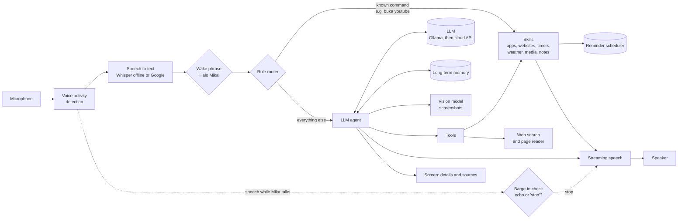
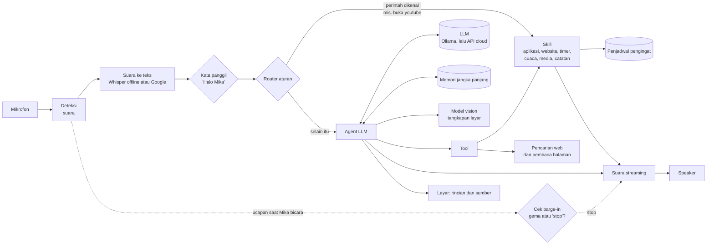

# Mika: Personal AI Voice Assistant for Windows

**English:** An Indonesian-speaking AI voice assistant that lives in the Windows tray. It holds natural conversations, searches the web and reads the answer aloud with its source, sets timers and reminders, checks the weather, and controls the laptop by voice. It can also look at your screen, summarize or translate copied text, give a morning briefing, and remember your preferences. Speech can be recognized fully offline, and you can cut Mika off mid-sentence.

**Bahasa Indonesia:** Asisten suara AI berbahasa Indonesia yang berjalan di system tray Windows. Mika bisa diajak ngobrol natural, mencari informasi di internet lalu membacakan jawabannya beserta sumbernya, memasang timer dan pengingat, mengecek cuaca, dan mengendalikan laptop lewat suara. Mika juga bisa melihat layarmu, merangkum atau menerjemahkan teks yang kamu copy, memberi briefing pagi, dan mengingat preferensimu. Pengenalan suaranya bisa sepenuhnya offline, dan Mika bisa dipotong saat sedang bicara.

| Read in English | Baca dalam Bahasa Indonesia |
|---|---|
| [Start here](#english) | [Mulai dari sini](#bahasa-indonesia) |

---

## English

### Reading guide

| Time you have | Read |
|---|---|
| 1 minute | [In short](#in-short) and [Example conversation](#example-conversation) |
| 3 minutes | + [Skills demonstrated](#skills-demonstrated) |
| 10 minutes (technical reviewers) | + [Architecture](#architecture), [Key engineering decisions](#key-engineering-decisions), [Code tour](#code-tour) |

Unfamiliar terms are explained in the [glossary](#glossary).

### In short

- **What:** a personal voice assistant like Alexa, but it runs on a Windows laptop and speaks casual Indonesian.
- **What makes it interesting:** it combines a local AI model that runs offline on a 4 GB laptop GPU, tool calling, live web search with cited sources, streaming speech, offline speech recognition (Whisper), barge-in, screen understanding with a local vision model, long-term memory, and Alexa-style skills (timers, reminders, weather, media, battery, notes, morning briefing), with safety rules enforced in code.
- **My role:** sole developer. I rebuilt an earlier rule-based version (one 1,650-line file) into a modular, tested AI agent while keeping every old feature working.
- **Quality:** 414 automated tests that run in about 3 seconds, with no microphone, speakers, screen, AI model, or internet needed.

### Example conversation

Mika's answers below are illustrative; the actions are what the code does.

| You say (in Indonesian) | What Mika does |
|---|---|
| "Halo Mika, buka YouTube" | Opens YouTube instantly, without calling the AI at all |
| "Halo Mika, harga emas hari ini berapa?" | Says "Bentar, Mika cariin dulu ya", searches the web, reads the top pages, then answers "Menurut Kompas, ..." |
| "Buka yang kedua" | Opens the second search result in the browser |
| "Pasang timer 5 menit buat masak mie" | Starts the timer; 5 minutes later: a chime and "Timer masak mie sudah selesai!" |
| "Ingatkan aku minum obat" | Asks "Mau diingatkan kapan?"; you answer "jam 9 malam" without saying "Halo Mika" again |
| "Cuaca besok di Bandung" | "Besok di Bandung diperkirakan hujan lokal ringan, 20 sampai 28 derajat ..." |
| "Kecilkan volume" / "lagu berikutnya" | Lowers the system volume / skips the track in Spotify or YouTube |
| "Stop" (while Mika is talking) | Mika goes quiet at once; her own voice coming back through the laptop speakers is not mistaken for you |
| "Lihat layarku, error ini artinya apa?" | Takes a screenshot (kept in memory only), asks a local vision model, answers in one or two sentences |
| "Terjemahkan yang aku copy ke Inggris" | Translates the copied text, reads it, and puts the translation back on the clipboard |
| "Ingat bahwa aku alergi udang" | Remembers it; later food suggestions take it into account. "Ingat bahwa PIN ATM-ku ..." is refused |
| "Selamat pagi" (before 11:00) | Morning briefing: date, weather, today's reminders, and two headlines |
| "Aku lagi capek nih" | Replies with empathy and remembers the conversation |
| "Matikan laptop" | Asks "Yakin?" and only shuts down after a spoken "iya" |

### Skills demonstrated

| Skill | Where to see it |
|---|---|
| LLM agent with tool calling (17 tools; rarely used ones are offered only when relevant) | [agent.py](mika/brain/agent.py), [toolset.py](mika/brain/toolset.py) |
| Several LLM providers, local first, automatic fallback | [mika/brain/llm/](mika/brain/llm/) |
| Multimodal: screen understanding with a local vision model, screenshots never saved | [vision.py](mika/skills/vision.py) |
| Long-term memory the user can list and delete by voice, with secret filtering | [store.py](mika/memory/store.py) |
| Prompt-injection defence by taint tracking: no memory writes after reading web, screen, or clipboard text | [tools.py](mika/brain/tools.py), [test_beyond.py](tests/test_beyond.py) |
| Indonesian time understanding ("jam setengah 8 malam", "besok pagi", "lima belas menit lagi") | [timeparse.py](mika/skills/timeparse.py) |
| Background scheduling that survives restarts and catches up on missed reminders | [reminders.py](mika/skills/reminders.py) |
| Windows integration: media keys, Core Audio volume, battery, Open-Meteo weather | [mika/skills/](mika/skills/) |
| Real-time audio: voice activity detection, endpointing, offline Whisper with automatic CPU/GPU choice | [vad.py](mika/audio/vad.py), [stt.py](mika/audio/stt.py) |
| Barge-in on laptop speakers without echo-cancellation hardware | [voice.py](mika/audio/voice.py) |
| Latency measured per turn, from the end of the user's speech | [metrics.py](mika/metrics.py) |
| Streaming voice: speaks while the model is still writing | [sentences.py](mika/brain/sentences.py), [speech.py](mika/audio/speech.py) |
| Web search, page reading, answers with cited sources | [web_search.py](mika/skills/web_search.py) |
| AI safety and prompt-injection defence | [tools.py](mika/brain/tools.py), [web_search.py](mika/skills/web_search.py) |
| Hybrid routing: fast rules first, AI for the rest | [router.py](mika/brain/router.py) |
| Testing AI features without a real model | [tests/](tests/) |
| Refactoring legacy code without breaking it | [assistant.py](assistant.py) (old entry point still works), [test_router.py](tests/test_router.py) |

### Architecture



### Key engineering decisions

1. **Rules first, AI second.** Known commands like "buka youtube" stay instant and work offline, because even a small local model adds a noticeable delay just to pick a tool. The router has no side effects, so its accuracy can be tested without a model.
2. **Local-first AI with automatic fallback.** Qwen3 4B runs in Ollama inside 4 GB of VRAM: free, private, and offline. An OpenAI-compatible API is the backup. A failed provider is skipped for 2 minutes instead of costing a timeout on every request, and the switch only happens before the first word is spoken.
3. **Speak while thinking.** Each sentence goes to text-to-speech as soon as it is complete, and the next one is synthesized while the current one plays. Spoken answers stay at 1 to 3 sentences; long details and sources appear on screen. Slow tools start with a short filler line, and simple actions skip a second AI call.
4. **Safety in code, not only in the prompt.** Risky actions (shutdown, restart) only create a pending action that runs after the user says "iya". The AI has no tool to delete files or run commands, cannot open program files or non-web links, and treats web pages as data: text that tries to inject instructions is cleaned before the model sees it, and only public websites are fetched.
5. **Small memory budget.** Conversation history keeps answers, not whole web pages, so it fits the 4k-token context of a small model.
6. **Graceful degradation.** No AI model available: Mika behaves like the old version. No search API key: a free fallback search. Online voice unavailable: the Windows voice.
7. **AI where it helps, code where it must be exact.** Small language models are unreliable at date arithmetic, so the AI only extracts the phrase ("besok jam 7 pagi") and a tested Indonesian time parser computes the moment. Mika always says the resolved time back ("Oke, Mika ingatkan minum obat jam 7 malam") so a misheard time is caught. Related tools are grouped (one `reminders` tool with an action field instead of six) to keep the tool list small for a 4k-token context.
8. **Offline speech that shares one small GPU.** Whisper and the LLM cannot both fit in 4 GB of VRAM, so Mika checks free VRAM and whether Ollama already holds the model, and runs Whisper on the CPU (int8) when needed; if the CUDA libraries are missing it falls back to the CPU instead of crashing. Known Whisper failure modes are filtered: invented phrases on silence ("Terima kasih telah menonton"), subtitle credits, and repetition loops.
9. **Barge-in without special hardware.** On laptop speakers the microphone hears Mika herself, and real echo cancellation needs special audio drivers. Instead, speech heard while Mika talks is transcribed and compared with what she just said: if it matches, it is her own echo and is ignored. Only a stop word ("stop", "cukup") or the wake phrase ("halo mika, ...") interrupts her, and the LLM stream is closed so the model stops generating. With headphones, a "voice" mode lets any speech interrupt.
10. **Memory that cannot be poisoned.** Facts the user asks Mika to remember live in a local file, are injected into the AI's context only when relevant, and can be listed and deleted by voice; wiping everything needs a spoken "iya". Passwords, PINs, card and ID numbers are refused. Each turn tracks whether the AI has read outside text (a web page, the screen, the clipboard); after that, the memory tool is refused, so a web page cannot plant a false "memory".
11. **Private by default, small context.** Screenshots stay in memory and go to the local vision model; sending them to a cloud model is an explicit opt-in. Rarely used tools (screen, clipboard, memory, shutdown) are offered to the model only when the user's sentence mentions their topic, which keeps the tool list small for a 4k-token context.

Problems found while testing on the real laptop, and fixed:

- The online voice (Edge TTS) was rejected by the server until the library was upgraded; its first call takes about 3 seconds, so it is now warmed up at startup (later calls take about 0.5 seconds).
- DuckDuckGo is DNS-blocked by some Indonesian internet providers, so the free search now tries other engines first.
- Wikipedia and Cloudflare-protected sites block clients that pretend to be a browser; an honest User-Agent fixed it.
- The old command parser opened apps whenever their name appeared anywhere ("apa itu python" launched Python); matching is now whole-word and needs a verb.
- Whisper adds sentence punctuation ("Kecilkan volume.") that broke exact command matching; transcripts are now cleaned while dots inside "kompas.com" or "19.30" are kept.
- Downloading the Whisper model through Hugging Face's newer "Xet" transfer stalled at 0 bytes on this network; plain HTTP works, so Mika uses it for the first download.
- On the GPU, Whisper loaded fine but crashed on its first sentence: the CUDA library (`cublas64_12.dll`) is only loaded at the first decode. Mika now runs a test decode when loading on the GPU and moves to the CPU if it fails (verified on this laptop). Whisper also sometimes writes the wake phrase as one word ("Halomika"), which is now recognized.
- A test written for stage 4 showed that the prompt-injection guard did not yet cover web search results; it does now.
- Since stage 1, a filler line ("Bentar, Mika cariin filenya.") had silently suppressed the confirmation of the action that followed; found by a stage 4 test and fixed.
- Microsoft Store apps (WhatsApp, Spotify, Settings, Camera: 163 entries on this laptop) have no shortcut file, so the Start Menu scan missed them, and "buka spotify" searched Spotify for the word "spotify". Mika now asks Windows for the full Start list (`Get-StartApps`, about 1.2 s in the background at startup) and opens Store apps the way the Start Menu does; Indonesian names and abbreviations ("pengaturan", "kamera", "wa", "vs code") work when the app is installed. Opening Calculator this way was verified on this laptop.

### Code tour

| Order | File | What to look for |
|---|---|---|
| 1 | [mika/assistant.py](mika/assistant.py) | The main flow for one spoken sentence |
| 2 | [mika/brain/router.py](mika/brain/router.py) | How Mika decides between a rule and the AI |
| 3 | [mika/brain/agent.py](mika/brain/agent.py) | The AI loop: stream, speak, call tools |
| 4 | [mika/brain/toolset.py](mika/brain/toolset.py) | What the AI may do, and what it is deliberately not allowed to do |
| 5 | [mika/brain/llm/fallback.py](mika/brain/llm/fallback.py) | Switching between local and cloud models |
| 6 | [mika/skills/timeparse.py](mika/skills/timeparse.py) | Turning Indonesian time phrases into exact times |
| 7 | [mika/audio/voice.py](mika/audio/voice.py) | Always-on listening and the barge-in decision |
| 8 | [mika/memory/store.py](mika/memory/store.py) | Long-term memory and what it refuses to store |
| 9 | [tests/test_assistant.py](tests/test_assistant.py) | End-to-end behaviour, readable as a specification |

Every class and function in the AI code has a one-line comment explaining what it does and why.

### Status and roadmap

| Stage | Content | Status |
|---|---|---|
| 1 | AI agent, tools, web search read aloud, streaming voice, tests | Done |
| 2 | Alexa-style skills: timers, reminders, alarms, weather, date and time, media and volume, battery, notes | Done |
| 3 | Offline speech recognition (Whisper + VAD), interrupting Mika while she speaks, per-turn latency log | Done |
| 4 | "Look at my screen" (vision), clipboard, morning briefing, news headlines, long-term memory | Done |
| 5 | Evaluation set, latency benchmark, demo video | Planned |

Measured so far on the target laptop (i7-11800H, RTX 3050 4 GB):

| What | Result |
|---|---|
| End of speech → transcript ready (VAD pause detection + Whisper, real-time pipeline) | about 0.7 s |
| Morning briefing (live weather + 4 RSS feeds in parallel) | 2.2 s · headlines alone 0.12 s |
| Speech recognition, 7 Indonesian commands (synthetic voice) | Google: 7/7 routed correctly, word error rate 0.04, 0.38 s · Whisper `tiny` on CPU: 4/7, word error rate 0.39, 0.24 s |
| Speech synthesis after warm-up | about 0.5 s per sentence |
| Web search plus page reading (free search) | 1 to 2.5 s |
| Weather | 0.7 s |
| Time, timers, battery, volume | instant, no internet needed |

Whisper `tiny` is fast but too inaccurate for Indonesian, so `small` is the recommended offline model; it was not measured because the model download ran at about 100 KB/s on the development network. Not yet measured: `small` accuracy, the vision model, and end-to-end AI response time (planned for stage 5). Details: [docs/ROADMAP.md](docs/ROADMAP.md).

### Tech stack

Python 3.11, Ollama (Qwen3 4B, Qwen2.5-VL 3B), OpenAI-compatible API, faster-whisper (CTranslate2), WebRTC VAD, httpx, Tavily / Brave Search / ddgs, trafilatura, RSS, Open-Meteo, Edge TTS, SpeechRecognition, PyAudio, Pillow, pyperclip, pycaw, psutil, pystray, Tkinter, PyInstaller, pytest.

### Run it locally

```powershell
python -m pip install -r requirements.txt
ollama pull qwen3:4b
ollama pull qwen2.5vl:3b            # optional, for "lihat layarku"
python assistant.py --text --mute   # type instead of talk, no sound
python mic_test.py                  # check the microphone and speech recognition
python tray_assistant.py            # full voice assistant in the system tray
python -m pytest                    # run the tests
```

API keys are optional and go in a `.env` file (see [.env.example](.env.example)); they are never committed. Full user guide (Indonesian): [docs/PANDUAN_PENGGUNA.md](docs/PANDUAN_PENGGUNA.md).

### Project structure

```text
mika/
  assistant.py      main flow for one utterance
  brain/            rule router, LLM agent, tools, prompt, conversation context
    llm/            Ollama, OpenAI-compatible, fallback chain, vision models
  memory/           long-term memory about the user
  skills/           apps/sites/files, web search, timers and reminders, weather, media, battery, notes,
                    screenshots, clipboard, news, morning briefing
  audio/            microphone, voice activity detection, speech to text, text to speech, barge-in
  ui/               tray app, settings window, on-screen details
tests/              414 tests with a fake microphone, speaker, clock, screen, clipboard, and LLM
docs/               roadmap and user guide
```

### Glossary

| Term | Meaning |
|---|---|
| LLM | Large language model, the technology behind ChatGPT |
| Local model | An LLM that runs on the laptop itself, so it is free, private, and works offline |
| Tool calling | The AI asks the app to run a function (open an app, search the web) instead of only writing text |
| Streaming | Using the answer while it is still being generated, so Mika starts talking sooner |
| Fallback | A backup that takes over automatically when the main option fails |
| Prompt injection | Text on a web page that tries to trick the AI into following its instructions |
| Vision model | An AI model that can read images, such as a screenshot |
| Taint tracking | Remembering that a turn has read untrusted text, and blocking risky actions afterwards |
| Mock | A fake component used in tests, such as a pretend microphone or AI model |

---

## Bahasa Indonesia

### Panduan membaca

| Waktu yang tersedia | Bagian yang dibaca |
|---|---|
| 1 menit | [Singkatnya](#singkatnya) dan [Contoh percakapan](#contoh-percakapan) |
| 3 menit | + [Kemampuan yang ditunjukkan](#kemampuan-yang-ditunjukkan) |
| 10 menit (reviewer teknis) | + [Arsitektur](#arsitektur), [Keputusan teknis utama](#keputusan-teknis-utama), [Tur kode](#tur-kode) |

Istilah teknis dijelaskan di [daftar istilah](#daftar-istilah).

### Singkatnya

- **Apa:** asisten suara pribadi seperti Alexa, tapi berjalan di laptop Windows dan berbicara bahasa Indonesia santai.
- **Yang menarik:** menggabungkan model AI lokal yang jalan offline di GPU laptop 4 GB, tool calling, pencarian web dengan sumber yang disebutkan, suara streaming, pengenalan suara offline (Whisper), barge-in, pemahaman layar dengan model vision lokal, memori jangka panjang, dan skill ala Alexa (timer, pengingat, cuaca, media, baterai, catatan, briefing pagi), dengan aturan keamanan yang dijaga di kode.
- **Peran saya:** developer tunggal. Saya membangun ulang versi lama yang berbasis aturan (satu file 1.650 baris) menjadi agent AI yang modular dan teruji, tanpa merusak fitur lama.
- **Kualitas:** 414 test otomatis yang selesai dalam sekitar 3 detik, tanpa butuh mikrofon, speaker, layar, model AI, atau internet.

### Contoh percakapan

Jawaban Mika di bawah ini hanya ilustrasi; aksinya sesuai dengan yang dikerjakan kode.

| Kamu bilang | Yang Mika lakukan |
|---|---|
| "Halo Mika, buka YouTube" | Langsung membuka YouTube tanpa memanggil AI |
| "Halo Mika, harga emas hari ini berapa?" | Bilang "Bentar, Mika cariin dulu ya", mencari di internet, membaca halaman teratas, lalu menjawab "Menurut Kompas, ..." |
| "Buka yang kedua" | Membuka hasil pencarian kedua di browser |
| "Pasang timer 5 menit buat masak mie" | Menyalakan timer; 5 menit kemudian berbunyi dan bilang "Timer masak mie sudah selesai!" |
| "Ingatkan aku minum obat" | Bertanya "Mau diingatkan kapan?"; kamu jawab "jam 9 malam" tanpa perlu bilang "Halo Mika" lagi |
| "Cuaca besok di Bandung" | "Besok di Bandung diperkirakan hujan lokal ringan, 20 sampai 28 derajat ..." |
| "Kecilkan volume" / "lagu berikutnya" | Mengecilkan volume laptop / melewati lagu di Spotify atau YouTube |
| "Stop" (saat Mika sedang bicara) | Mika langsung diam; suaranya sendiri yang terdengar balik dari speaker laptop tidak dikira suaramu |
| "Lihat layarku, error ini artinya apa?" | Mengambil tangkapan layar (hanya di memori), bertanya ke model vision lokal, lalu menjawab dalam satu-dua kalimat |
| "Terjemahkan yang aku copy ke Inggris" | Menerjemahkan teks yang di-copy, membacakannya, lalu menaruh terjemahannya kembali di clipboard |
| "Ingat bahwa aku alergi udang" | Mengingatnya; saran makanan berikutnya ikut memperhitungkannya. "Ingat bahwa PIN ATM-ku ..." ditolak |
| "Selamat pagi" (sebelum pukul 11.00) | Briefing pagi: tanggal, cuaca, pengingat hari ini, dan dua judul berita |
| "Aku lagi capek nih" | Menjawab dengan empati dan mengingat percakapan |
| "Matikan laptop" | Bertanya "Yakin?" dan baru mematikan laptop setelah dijawab "iya" |

### Kemampuan yang ditunjukkan

| Kemampuan | Lihat di |
|---|---|
| Agent LLM dengan tool calling (17 tool; yang jarang dipakai hanya ditawarkan saat relevan) | [agent.py](mika/brain/agent.py), [toolset.py](mika/brain/toolset.py) |
| Beberapa provider LLM, lokal dulu, fallback otomatis | [mika/brain/llm/](mika/brain/llm/) |
| Multimodal: memahami layar dengan model vision lokal, tangkapan layar tidak pernah disimpan | [vision.py](mika/skills/vision.py) |
| Memori jangka panjang yang bisa dilihat dan dihapus lewat suara, dengan penyaring data rahasia | [store.py](mika/memory/store.py) |
| Pertahanan prompt injection lewat taint tracking: tidak ada penyimpanan memori setelah membaca teks dari web, layar, atau clipboard | [tools.py](mika/brain/tools.py), [test_beyond.py](tests/test_beyond.py) |
| Memahami ungkapan waktu bahasa Indonesia ("jam setengah 8 malam", "besok pagi", "lima belas menit lagi") | [timeparse.py](mika/skills/timeparse.py) |
| Penjadwalan di latar belakang yang tetap jalan setelah restart dan mengejar pengingat yang terlewat | [reminders.py](mika/skills/reminders.py) |
| Integrasi Windows: tombol media, volume Core Audio, baterai, cuaca Open-Meteo | [mika/skills/](mika/skills/) |
| Audio real-time: deteksi suara (VAD), penentuan akhir ucapan, Whisper offline dengan pilihan CPU/GPU otomatis | [vad.py](mika/audio/vad.py), [stt.py](mika/audio/stt.py) |
| Barge-in di speaker laptop tanpa perangkat peredam gema | [voice.py](mika/audio/voice.py) |
| Latensi diukur per giliran, dihitung dari akhir ucapan pengguna | [metrics.py](mika/metrics.py) |
| Suara streaming: mulai bicara sebelum AI selesai menulis | [sentences.py](mika/brain/sentences.py), [speech.py](mika/audio/speech.py) |
| Pencarian web, membaca halaman, jawaban dengan sumber | [web_search.py](mika/skills/web_search.py) |
| Keamanan AI dan pertahanan terhadap prompt injection | [tools.py](mika/brain/tools.py), [web_search.py](mika/skills/web_search.py) |
| Routing hibrida: aturan cepat dulu, AI untuk sisanya | [router.py](mika/brain/router.py) |
| Menguji fitur AI tanpa model sungguhan | [tests/](tests/) |
| Refactor kode lama tanpa merusaknya | [assistant.py](assistant.py) (entry point lama tetap jalan), [test_router.py](tests/test_router.py) |

### Arsitektur



### Keputusan teknis utama

1. **Aturan dulu, AI kemudian.** Perintah yang sudah dikenal seperti "buka youtube" tetap instan dan jalan offline, karena model lokal yang kecil pun menambah jeda yang terasa hanya untuk memilih tool. Router tidak punya efek samping, jadi akurasinya bisa diuji tanpa model.
2. **AI lokal dengan fallback otomatis.** Qwen3 4B berjalan di Ollama dalam VRAM 4 GB: gratis, privat, dan offline. API yang kompatibel dengan OpenAI menjadi cadangan. Provider yang gagal dilewati selama 2 menit supaya tidak menambah waktu tunggu di setiap permintaan, dan perpindahan hanya terjadi sebelum kata pertama diucapkan.
3. **Bicara sambil berpikir.** Setiap kalimat langsung diubah jadi suara begitu selesai, dan kalimat berikutnya disiapkan selagi kalimat sekarang diputar. Jawaban suara dibatasi 1 sampai 3 kalimat; rincian panjang dan sumber tampil di layar. Tool yang lambat diawali kalimat pengisi singkat, dan aksi sederhana tidak perlu panggilan AI kedua.
4. **Keamanan di kode, bukan hanya di prompt.** Aksi berisiko (mematikan, restart) hanya membuat aksi tertunda yang dijalankan setelah pengguna bilang "iya". AI tidak punya tool untuk menghapus file atau menjalankan perintah, tidak bisa membuka file program atau link non-web, dan memperlakukan halaman web sebagai data: teks yang mencoba menyisipkan instruksi dibersihkan sebelum dibaca model, dan hanya situs publik yang diambil.
5. **Memori yang hemat.** Riwayat percakapan menyimpan jawaban, bukan isi halaman web, supaya muat di konteks 4k token milik model kecil.
6. **Tetap berfungsi saat ada yang mati.** Model AI tidak tersedia: Mika kembali ke perilaku versi lama. Tidak ada API key pencarian: pakai pencarian gratis. Suara online mati: pakai suara Windows.
7. **AI untuk yang butuh fleksibel, kode untuk yang harus tepat.** Model bahasa kecil sering salah menghitung tanggal, jadi AI hanya mengambil ungkapannya ("besok jam 7 pagi") dan parser waktu bahasa Indonesia yang teruji menghitung waktunya. Mika selalu mengulang waktu yang dipahami ("Oke, Mika ingatkan minum obat jam 7 malam") supaya salah dengar langsung ketahuan. Tool yang berkaitan digabung (satu tool `reminders` dengan pilihan aksi, bukan enam tool) supaya daftar tool tetap ringkas untuk konteks 4k token.
8. **Suara offline yang berbagi satu GPU kecil.** Whisper dan LLM tidak muat bersamaan di VRAM 4 GB, jadi Mika mengecek sisa VRAM dan apakah Ollama sudah memuat modelnya, lalu menjalankan Whisper di CPU (int8) bila perlu; kalau library CUDA tidak ada, ia pindah ke CPU alih-alih crash. Kegagalan khas Whisper disaring: kalimat karangan saat hening ("Terima kasih telah menonton"), baris kredit subtitle, dan pengulangan.
9. **Barge-in tanpa perangkat khusus.** Di speaker laptop, mikrofon ikut mendengar suara Mika sendiri, dan peredam gema sungguhan butuh driver audio khusus. Sebagai gantinya, ucapan yang terdengar saat Mika bicara ditranskrip lalu dibandingkan dengan kalimat yang baru saja ia ucapkan: kalau mirip, itu gema dan diabaikan. Hanya kata henti ("stop", "cukup") atau kata panggil ("halo mika, ...") yang memotongnya, dan aliran LLM ditutup supaya model berhenti menghasilkan teks. Dengan headset, mode "voice" membuat ucapan apa pun bisa memotong.
10. **Memori yang tidak bisa diracuni.** Hal yang diminta pengguna untuk diingat disimpan di file lokal, dimasukkan ke konteks AI hanya saat relevan, dan bisa dilihat serta dihapus lewat suara; menghapus semuanya butuh jawaban "iya". Password, PIN, nomor kartu, dan nomor identitas ditolak. Setiap giliran mencatat apakah AI sudah membaca teks dari luar (halaman web, layar, clipboard); setelah itu tool memori ditolak, jadi halaman web tidak bisa menanam "ingatan palsu".
11. **Privat secara default, konteks hemat.** Tangkapan layar hanya ada di memori dan dikirim ke model vision lokal; mengirimnya ke model cloud harus dinyalakan sendiri. Tool yang jarang dipakai (layar, clipboard, memori, shutdown) hanya ditawarkan ke model saat kalimat pengguna menyinggung topiknya, supaya daftar tool tetap muat di konteks 4k token.

Masalah yang ditemukan saat diuji di laptop sungguhan, dan sudah diperbaiki:

- Suara online (Edge TTS) ditolak server sampai library-nya di-upgrade; panggilan pertamanya butuh sekitar 3 detik, jadi sekarang dipanaskan saat startup (panggilan berikutnya sekitar 0,5 detik).
- DuckDuckGo diblokir DNS oleh sebagian provider internet Indonesia, jadi pencarian gratis sekarang mencoba mesin lain lebih dulu.
- Wikipedia dan situs ber-Cloudflare memblokir klien yang menyamar sebagai browser; User-Agent yang jujur menyelesaikannya.
- Parser perintah lama membuka aplikasi setiap kali namanya muncul di kalimat ("apa itu python" membuka Python); sekarang harus kata utuh dan disertai kata kerja.
- Whisper menambahkan tanda baca ("Kecilkan volume.") yang membuat perintah tidak cocok; transkrip sekarang dibersihkan, tapi titik di dalam "kompas.com" atau "19.30" tetap dipertahankan.
- Mengunduh model Whisper lewat jalur "Xet" milik Hugging Face macet di 0 byte di jaringan ini; HTTP biasa berhasil, jadi Mika memakainya untuk unduhan pertama.
- Di GPU, Whisper berhasil dimuat tapi crash di kalimat pertama: library CUDA (`cublas64_12.dll`) baru dimuat saat transkripsi pertama. Sekarang Mika melakukan transkripsi uji saat memuat di GPU dan pindah ke CPU kalau gagal (sudah dicek di laptop ini). Whisper juga kadang menulis kata panggil dempet ("Halomika"), yang sekarang dikenali.
- Test yang ditulis untuk tahap 4 menunjukkan pengaman prompt injection belum mencakup hasil pencarian web; sekarang sudah.
- Sejak tahap 1, kalimat pengisi ("Bentar, Mika cariin filenya.") diam-diam membuat konfirmasi aksi berikutnya tidak diucapkan; ditemukan oleh test tahap 4 dan sudah diperbaiki.
- Aplikasi Microsoft Store (WhatsApp, Spotify, Settings, Camera: 163 entri di laptop ini) tidak punya file shortcut, jadi scan Start Menu melewatkannya, dan "buka spotify" malah mencari kata "spotify" di Spotify. Sekarang Mika meminta daftar Start lengkap dari Windows (`Get-StartApps`, sekitar 1,2 detik di belakang saat startup) dan membuka aplikasi Store dengan cara yang sama seperti Start Menu; sebutan Indonesia dan singkatan ("pengaturan", "kamera", "wa", "vs code") ikut dikenali kalau aplikasinya terpasang. Membuka Kalkulator dengan cara ini sudah dicek di laptop ini.

### Tur kode

| Urutan | File | Yang perlu dilihat |
|---|---|---|
| 1 | [mika/assistant.py](mika/assistant.py) | Alur utama untuk satu kalimat yang diucapkan |
| 2 | [mika/brain/router.py](mika/brain/router.py) | Cara Mika memilih antara aturan dan AI |
| 3 | [mika/brain/agent.py](mika/brain/agent.py) | Loop AI: streaming, bicara, memanggil tool |
| 4 | [mika/brain/toolset.py](mika/brain/toolset.py) | Apa yang boleh dilakukan AI, dan apa yang sengaja tidak diizinkan |
| 5 | [mika/brain/llm/fallback.py](mika/brain/llm/fallback.py) | Perpindahan antara model lokal dan cloud |
| 6 | [mika/skills/timeparse.py](mika/skills/timeparse.py) | Mengubah ungkapan waktu bahasa Indonesia menjadi waktu yang tepat |
| 7 | [mika/audio/voice.py](mika/audio/voice.py) | Mendengar terus-menerus dan keputusan barge-in |
| 8 | [mika/memory/store.py](mika/memory/store.py) | Memori jangka panjang dan apa yang ditolak untuk disimpan |
| 9 | [tests/test_assistant.py](tests/test_assistant.py) | Perilaku end-to-end, bisa dibaca seperti spesifikasi |

Setiap class dan fungsi di kode AI punya komentar satu baris yang menjelaskan apa yang dilakukannya dan alasannya.

### Status dan rencana

| Tahap | Isi | Status |
|---|---|---|
| 1 | Agent AI, tool, pencarian web yang dibacakan, suara streaming, test | Selesai |
| 2 | Skill ala Alexa: timer, pengingat, alarm, cuaca, jam dan tanggal, media dan volume, baterai, catatan | Selesai |
| 3 | Pengenalan suara offline (Whisper + VAD), memotong Mika saat sedang bicara, log latensi per giliran | Selesai |
| 4 | "Lihat layarku" (vision), clipboard, briefing pagi, judul berita, memori jangka panjang | Selesai |
| 5 | Dataset evaluasi, benchmark latensi, video demo | Direncanakan |

Yang sudah diukur di laptop target (i7-11800H, RTX 3050 4 GB):

| Yang diukur | Hasil |
|---|---|
| Akhir ucapan → transkrip siap (deteksi jeda VAD + Whisper, pipeline real-time) | sekitar 0,7 detik |
| Briefing pagi (cuaca langsung + 4 feed RSS paralel) | 2,2 detik · judul berita saja 0,12 detik |
| Pengenalan suara, 7 perintah bahasa Indonesia (suara sintetis) | Google: 7/7 rute benar, word error rate 0,04, 0,38 detik · Whisper `tiny` di CPU: 4/7, word error rate 0,39, 0,24 detik |
| Sintesis suara setelah pemanasan | sekitar 0,5 detik per kalimat |
| Pencarian web plus membaca halaman (pencarian gratis) | 1 sampai 2,5 detik |
| Cuaca | 0,7 detik |
| Jam, timer, baterai, volume | langsung, tanpa internet |

Whisper `tiny` cepat tapi terlalu tidak akurat untuk bahasa Indonesia, jadi model offline yang disarankan adalah `small`; model itu belum diukur karena unduhannya hanya sekitar 100 KB/detik di jaringan pengembangan. Yang belum diukur: akurasi `small`, model vision, dan waktu respons AI end-to-end (direncanakan di tahap 5). Detail: [docs/ROADMAP.md](docs/ROADMAP.md).

### Teknologi

Python 3.11, Ollama (Qwen3 4B, Qwen2.5-VL 3B), API kompatibel OpenAI, faster-whisper (CTranslate2), WebRTC VAD, httpx, Tavily / Brave Search / ddgs, trafilatura, RSS, Open-Meteo, Edge TTS, SpeechRecognition, PyAudio, Pillow, pyperclip, pycaw, psutil, pystray, Tkinter, PyInstaller, pytest.

### Menjalankan di laptop sendiri

```powershell
python -m pip install -r requirements.txt
ollama pull qwen3:4b
ollama pull qwen2.5vl:3b            # opsional, untuk "lihat layarku"
python assistant.py --text --mute   # mengetik, bukan bicara, tanpa suara
python mic_test.py                  # mengecek mikrofon dan pengenalan suara
python tray_assistant.py            # asisten suara lengkap di system tray
python -m pytest                    # menjalankan test
```

API key bersifat opsional dan disimpan di file `.env` (lihat [.env.example](.env.example)); file ini tidak pernah masuk Git. Panduan pemakaian lengkap: [docs/PANDUAN_PENGGUNA.md](docs/PANDUAN_PENGGUNA.md).

### Struktur proyek

```text
mika/
  assistant.py      alur utama untuk satu ucapan
  brain/            router aturan, agent LLM, tool, prompt, konteks percakapan
    llm/            Ollama, API kompatibel OpenAI, rantai fallback, model vision
  memory/           memori jangka panjang tentang pengguna
  skills/           aplikasi/website/file, pencarian web, timer dan pengingat, cuaca, media, baterai, catatan,
                    tangkapan layar, clipboard, berita, briefing pagi
  audio/            mikrofon, deteksi suara, suara ke teks, teks ke suara, barge-in
  ui/               aplikasi tray, jendela settings, rincian di layar
tests/              414 test dengan mikrofon, speaker, jam, layar, clipboard, dan LLM palsu
docs/               rencana dan panduan pengguna
```

### Daftar istilah

| Istilah | Arti |
|---|---|
| LLM | Large language model, teknologi di balik ChatGPT |
| Model lokal | LLM yang berjalan di laptop sendiri, jadi gratis, privat, dan bisa offline |
| Tool calling | AI meminta aplikasi menjalankan fungsi (membuka aplikasi, mencari di web), bukan hanya menulis teks |
| Streaming | Memakai jawaban selagi masih dibuat, sehingga Mika bisa mulai bicara lebih cepat |
| Fallback | Cadangan yang otomatis mengambil alih saat pilihan utama gagal |
| Prompt injection | Teks di halaman web yang mencoba menipu AI agar mengikuti instruksinya |
| Model vision | Model AI yang bisa membaca gambar, misalnya tangkapan layar |
| Taint tracking | Mencatat bahwa satu giliran sudah membaca teks yang tidak tepercaya, lalu memblokir aksi berisiko sesudahnya |
| Mock | Komponen palsu untuk test, misalnya mikrofon atau model AI pura-pura |
